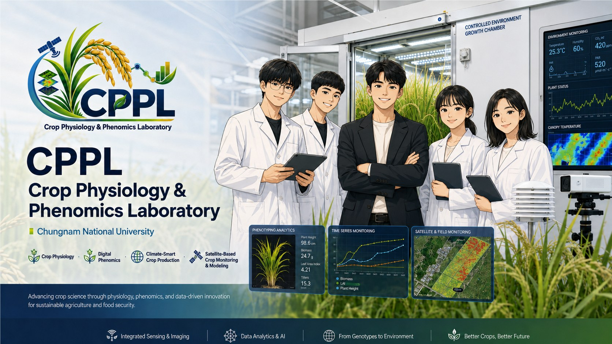

  

    
  

  <section class="cppl-intro">
    
CPPL · Chungnam National University

    <h1>Crop Physiology &amp; Phenomics Laboratory</h1>
    
Chungnam National University

    
We find new research directions through understanding crops.

    <a class="cppl-philosophy-link" href="/research/#research-philosophy">Our research philosophy →</a>
  </section>

  

  

    <a href="/research/"><strong>Explore Research →</strong>Research vision, approaches, and current themes</a>
    <a href="/members/"><strong>Meet the CPPL Team →</strong>Graduate students and undergraduate researchers</a>
    <a href="/opportunities/"><strong>Join CPPL →</strong>Graduate and undergraduate research opportunities</a>
  

