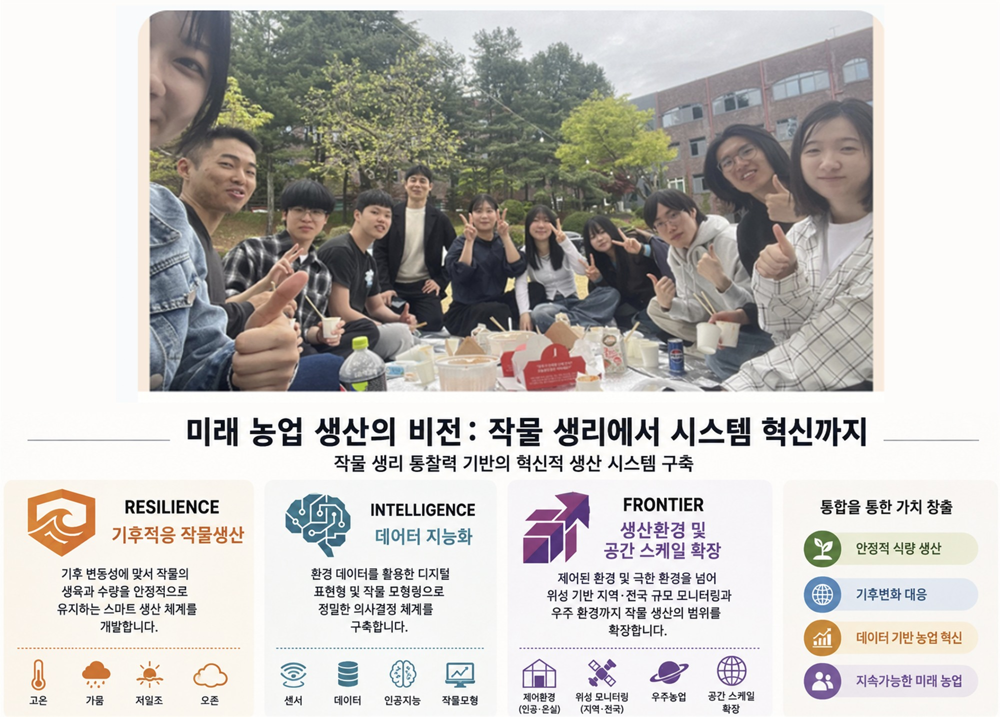

  

  

    
Our Team

    <h2>People at CPPL</h2>
    
CPPL brings together graduate students and undergraduate researchers working across crop physiology, climate-smart production, phenomics, modeling, and remote sensing.

  

<h2 class="cppl-member-section-title">Ph.D. Students</h2>

  <article class="cppl-member-card cppl-member-profile-card">
    
<svg class="cppl-avatar-ill" viewBox="0 0 120 140" aria-hidden="true"><circle cx="60" cy="70" r="54" fill="var(--avatar-bg)"/><path d="M26 118c7-23 61-23 68 0v16H26z" fill="var(--avatar-shirt)"/><circle cx="60" cy="65" r="29" fill="#f2d2bd"/><path d="M31 63c0-29 18-43 31-43 20 0 30 17 28 43-8-14-18-20-31-20-12 0-21 6-28 20z" fill="var(--avatar-hair)"/><circle cx="49" cy="66" r="3" fill="#26333d"/><circle cx="72" cy="66" r="3" fill="#26333d"/><path d="M54 79c4 4 9 4 13 0" fill="none" stroke="#b66f69" stroke-width="2.5" stroke-linecap="round"/><circle cx="42" cy="76" r="4" fill="#efb7ad" opacity=".55"/><circle cx="78" cy="76" r="4" fill="#efb7ad" opacity=".55"/></svg>🌱

    
<h3>조소혜</h3>
Ph.D. Student
<a class="cppl-member-email" href="mailto:josohye98@cropcnu.com">✉ josohye98@cropcnu.com</a>

  </article>

  <article class="cppl-member-card cppl-member-profile-card cppl-member-parttime">
    
<svg class="cppl-avatar-ill" viewBox="0 0 120 140" aria-hidden="true"><circle cx="60" cy="70" r="54" fill="var(--avatar-bg)"/><path d="M26 118c7-23 61-23 68 0v16H26z" fill="var(--avatar-shirt)"/><circle cx="60" cy="65" r="29" fill="#f2d2bd"/><path d="M31 63c0-29 18-43 31-43 20 0 30 17 28 43-8-14-18-20-31-20-12 0-21 6-28 20z" fill="var(--avatar-hair)"/><circle cx="49" cy="66" r="3" fill="#26333d"/><circle cx="72" cy="66" r="3" fill="#26333d"/><path d="M54 79c4 4 9 4 13 0" fill="none" stroke="#b66f69" stroke-width="2.5" stroke-linecap="round"/><circle cx="42" cy="76" r="4" fill="#efb7ad" opacity=".55"/><circle cx="78" cy="76" r="4" fill="#efb7ad" opacity=".55"/></svg>🌾

    
<h3>김주희</h3>
Ph.D. Student

Crop Cultivation &amp; Physiology Division · National Institute of Crop Science, RDA
<a class="cppl-member-email" href="mailto:uj71103@cropcnu.com">✉ uj71103@cropcnu.com</a>Part-time

  </article>

  <article class="cppl-member-card cppl-member-profile-card cppl-member-parttime">
    
<svg class="cppl-avatar-ill" viewBox="0 0 120 140" aria-hidden="true"><circle cx="60" cy="70" r="54" fill="var(--avatar-bg)"/><path d="M26 118c7-23 61-23 68 0v16H26z" fill="var(--avatar-shirt)"/><circle cx="60" cy="65" r="29" fill="#f2d2bd"/><path d="M31 63c0-29 18-43 31-43 20 0 30 17 28 43-8-14-18-20-31-20-12 0-21 6-28 20z" fill="var(--avatar-hair)"/><circle cx="49" cy="66" r="3" fill="#26333d"/><circle cx="72" cy="66" r="3" fill="#26333d"/><path d="M54 79c4 4 9 4 13 0" fill="none" stroke="#b66f69" stroke-width="2.5" stroke-linecap="round"/><circle cx="42" cy="76" r="4" fill="#efb7ad" opacity=".55"/><circle cx="78" cy="76" r="4" fill="#efb7ad" opacity=".55"/></svg>🔬

    
<h3>송영서</h3>
Ph.D. Student

Crop Cultivation &amp; Physiology Division · National Institute of Crop Science, RDA
Part-time

  </article>

<h2 class="cppl-member-section-title">M.S. Students</h2>

  <article class="cppl-member-card cppl-member-profile-card">
    
<svg class="cppl-avatar-ill" viewBox="0 0 120 140" aria-hidden="true"><circle cx="60" cy="70" r="54" fill="var(--avatar-bg)"/><path d="M26 118c7-23 61-23 68 0v16H26z" fill="var(--avatar-shirt)"/><circle cx="60" cy="65" r="29" fill="#f2d2bd"/><path d="M31 63c0-29 18-43 31-43 20 0 30 17 28 43-8-14-18-20-31-20-12 0-21 6-28 20z" fill="var(--avatar-hair)"/><circle cx="49" cy="66" r="3" fill="#26333d"/><circle cx="72" cy="66" r="3" fill="#26333d"/><path d="M54 79c4 4 9 4 13 0" fill="none" stroke="#b66f69" stroke-width="2.5" stroke-linecap="round"/><circle cx="42" cy="76" r="4" fill="#efb7ad" opacity=".55"/><circle cx="78" cy="76" r="4" fill="#efb7ad" opacity=".55"/></svg>📈

    
<h3>양진우</h3>
M.S. Student
<a class="cppl-member-email" href="mailto:yangjinwoo8424@cropcnu.com">✉ yangjinwoo8424@cropcnu.com</a>

  </article>

<h2 class="cppl-member-section-title">B.S.–M.S. Integrated Program</h2>

  <article class="cppl-member-card cppl-member-profile-card">
    
<svg class="cppl-avatar-ill" viewBox="0 0 120 140" aria-hidden="true"><circle cx="60" cy="70" r="54" fill="var(--avatar-bg)"/><path d="M26 118c7-23 61-23 68 0v16H26z" fill="var(--avatar-shirt)"/><circle cx="60" cy="65" r="29" fill="#f2d2bd"/><path d="M31 63c0-29 18-43 31-43 20 0 30 17 28 43-8-14-18-20-31-20-12 0-21 6-28 20z" fill="var(--avatar-hair)"/><circle cx="49" cy="66" r="3" fill="#26333d"/><circle cx="72" cy="66" r="3" fill="#26333d"/><path d="M54 79c4 4 9 4 13 0" fill="none" stroke="#b66f69" stroke-width="2.5" stroke-linecap="round"/><circle cx="42" cy="76" r="4" fill="#efb7ad" opacity=".55"/><circle cx="78" cy="76" r="4" fill="#efb7ad" opacity=".55"/></svg>🌿

    
<h3>유지승</h3>
B.S.–M.S. Integrated Program Student
<a class="cppl-member-email" href="mailto:jsy020623@cropcnu.com">✉ jsy020623@cropcnu.com</a>Integrated Program

  </article>

<h2 class="cppl-member-section-title">Undergraduate Researchers</h2>

  <article class="cppl-member-card cppl-member-profile-card">
    
<svg class="cppl-avatar-ill" viewBox="0 0 120 140" aria-hidden="true"><circle cx="60" cy="70" r="54" fill="var(--avatar-bg)"/><path d="M26 118c7-23 61-23 68 0v16H26z" fill="var(--avatar-shirt)"/><circle cx="60" cy="65" r="29" fill="#f2d2bd"/><path d="M31 63c0-29 18-43 31-43 20 0 30 17 28 43-8-14-18-20-31-20-12 0-21 6-28 20z" fill="var(--avatar-hair)"/><circle cx="49" cy="66" r="3" fill="#26333d"/><circle cx="72" cy="66" r="3" fill="#26333d"/><path d="M54 79c4 4 9 4 13 0" fill="none" stroke="#b66f69" stroke-width="2.5" stroke-linecap="round"/><circle cx="42" cy="76" r="4" fill="#efb7ad" opacity=".55"/><circle cx="78" cy="76" r="4" fill="#efb7ad" opacity=".55"/></svg>☀️

    
<h3>오정민</h3>
Undergraduate Researcher
<a class="cppl-member-email" href="mailto:mayoh0524@cropcnu.com">✉ mayoh0524@cropcnu.com</a>Prospective M.S.

  </article>

  <article class="cppl-member-card cppl-member-profile-card">
    
<svg class="cppl-avatar-ill" viewBox="0 0 120 140" aria-hidden="true"><circle cx="60" cy="70" r="54" fill="var(--avatar-bg)"/><path d="M26 118c7-23 61-23 68 0v16H26z" fill="var(--avatar-shirt)"/><circle cx="60" cy="65" r="29" fill="#f2d2bd"/><path d="M31 63c0-29 18-43 31-43 20 0 30 17 28 43-8-14-18-20-31-20-12 0-21 6-28 20z" fill="var(--avatar-hair)"/><circle cx="49" cy="66" r="3" fill="#26333d"/><circle cx="72" cy="66" r="3" fill="#26333d"/><path d="M54 79c4 4 9 4 13 0" fill="none" stroke="#b66f69" stroke-width="2.5" stroke-linecap="round"/><circle cx="42" cy="76" r="4" fill="#efb7ad" opacity=".55"/><circle cx="78" cy="76" r="4" fill="#efb7ad" opacity=".55"/></svg>🌸

    
<h3>나규린</h3>
Undergraduate Researcher
<a class="cppl-member-email" href="mailto:nagyurin0615@cropcnu.com">✉ nagyurin0615@cropcnu.com</a>

  </article>

  <article class="cppl-member-card cppl-member-profile-card">
    
<svg class="cppl-avatar-ill" viewBox="0 0 120 140" aria-hidden="true"><circle cx="60" cy="70" r="54" fill="var(--avatar-bg)"/><path d="M26 118c7-23 61-23 68 0v16H26z" fill="var(--avatar-shirt)"/><circle cx="60" cy="65" r="29" fill="#f2d2bd"/><path d="M31 63c0-29 18-43 31-43 20 0 30 17 28 43-8-14-18-20-31-20-12 0-21 6-28 20z" fill="var(--avatar-hair)"/><circle cx="49" cy="66" r="3" fill="#26333d"/><circle cx="72" cy="66" r="3" fill="#26333d"/><path d="M54 79c4 4 9 4 13 0" fill="none" stroke="#b66f69" stroke-width="2.5" stroke-linecap="round"/><circle cx="42" cy="76" r="4" fill="#efb7ad" opacity=".55"/><circle cx="78" cy="76" r="4" fill="#efb7ad" opacity=".55"/></svg>💧

    
<h3>한유나</h3>
Undergraduate Researcher
<a class="cppl-member-email" href="mailto:hangou9145@cropcnu.com">✉ hangou9145@cropcnu.com</a>

  </article>

  <article class="cppl-member-card cppl-member-profile-card">
    
<svg class="cppl-avatar-ill" viewBox="0 0 120 140" aria-hidden="true"><circle cx="60" cy="70" r="54" fill="var(--avatar-bg)"/><path d="M26 118c7-23 61-23 68 0v16H26z" fill="var(--avatar-shirt)"/><circle cx="60" cy="65" r="29" fill="#f2d2bd"/><path d="M31 63c0-29 18-43 31-43 20 0 30 17 28 43-8-14-18-20-31-20-12 0-21 6-28 20z" fill="var(--avatar-hair)"/><circle cx="49" cy="66" r="3" fill="#26333d"/><circle cx="72" cy="66" r="3" fill="#26333d"/><path d="M54 79c4 4 9 4 13 0" fill="none" stroke="#b66f69" stroke-width="2.5" stroke-linecap="round"/><circle cx="42" cy="76" r="4" fill="#efb7ad" opacity=".55"/><circle cx="78" cy="76" r="4" fill="#efb7ad" opacity=".55"/></svg>🌾

    
<h3>박한빈</h3>
Undergraduate Researcher
<a class="cppl-member-email" href="mailto:parkhb602@cropcnu.com">✉ parkhb602@cropcnu.com</a>

  </article>
  <article id="member-son-chaeeun" class="cppl-member-card cppl-member-profile-card" data-member="son-chaeeun">
    
🌱

    
<h3>손채은</h3>
Undergraduate Researcher
<a class="cppl-member-email" href="mailto:topokki1206@cropcnu.com">✉ topokki1206@cropcnu.com</a>

  </article>

<h2 class="cppl-member-section-title">Members on Leave</h2>

  <article class="cppl-member-card cppl-member-profile-card cppl-member-muted">
    
<svg class="cppl-avatar-ill" viewBox="0 0 120 140" aria-hidden="true"><circle cx="60" cy="70" r="54" fill="var(--avatar-bg)"/><path d="M26 118c7-23 61-23 68 0v16H26z" fill="var(--avatar-shirt)"/><circle cx="60" cy="65" r="29" fill="#f2d2bd"/><path d="M31 63c0-29 18-43 31-43 20 0 30 17 28 43-8-14-18-20-31-20-12 0-21 6-28 20z" fill="var(--avatar-hair)"/><circle cx="49" cy="66" r="3" fill="#26333d"/><circle cx="72" cy="66" r="3" fill="#26333d"/><path d="M54 79c4 4 9 4 13 0" fill="none" stroke="#b66f69" stroke-width="2.5" stroke-linecap="round"/><circle cx="42" cy="76" r="4" fill="#efb7ad" opacity=".55"/><circle cx="78" cy="76" r="4" fill="#efb7ad" opacity=".55"/></svg>🎖️

    
<h3>김태수</h3>
Undergraduate Researcher
<a class="cppl-member-email" href="mailto:megaqua0804@cropcnu.com">✉ megaqua0804@cropcnu.com</a>Military Service

  </article>

  <article class="cppl-member-card cppl-member-profile-card cppl-member-muted">
    
<svg class="cppl-avatar-ill" viewBox="0 0 120 140" aria-hidden="true"><circle cx="60" cy="70" r="54" fill="var(--avatar-bg)"/><path d="M26 118c7-23 61-23 68 0v16H26z" fill="var(--avatar-shirt)"/><circle cx="60" cy="65" r="29" fill="#f2d2bd"/><path d="M31 63c0-29 18-43 31-43 20 0 30 17 28 43-8-14-18-20-31-20-12 0-21 6-28 20z" fill="var(--avatar-hair)"/><circle cx="49" cy="66" r="3" fill="#26333d"/><circle cx="72" cy="66" r="3" fill="#26333d"/><path d="M54 79c4 4 9 4 13 0" fill="none" stroke="#b66f69" stroke-width="2.5" stroke-linecap="round"/><circle cx="42" cy="76" r="4" fill="#efb7ad" opacity=".55"/><circle cx="78" cy="76" r="4" fill="#efb7ad" opacity=".55"/></svg>🌼

    
<h3>강채유</h3>
Undergraduate Researcher
On Leave

  </article>

<h2 id="former-undergraduate-researchers" class="cppl-member-section-title">Former Undergraduate Researchers</h2>
<ul class="cppl-former-members">
  <li><strong>박민영, 송영호, 장래찬</strong>(2020–2021)</li>
  <li><strong>김은영, 송화섭, 정효경</strong>(2021–2022)</li>
  <li><strong>김지민, 이예빈, 한지윤</strong>(2022–2023)</li>
  <li><strong>공윤희, 김다은, 이상훈</strong>(2023–2024)</li>
  <li><strong>문상윤, 신재효, 최효리</strong>(2024–2025)</li>
  <li><strong>이준섭</strong></li>
</ul>

